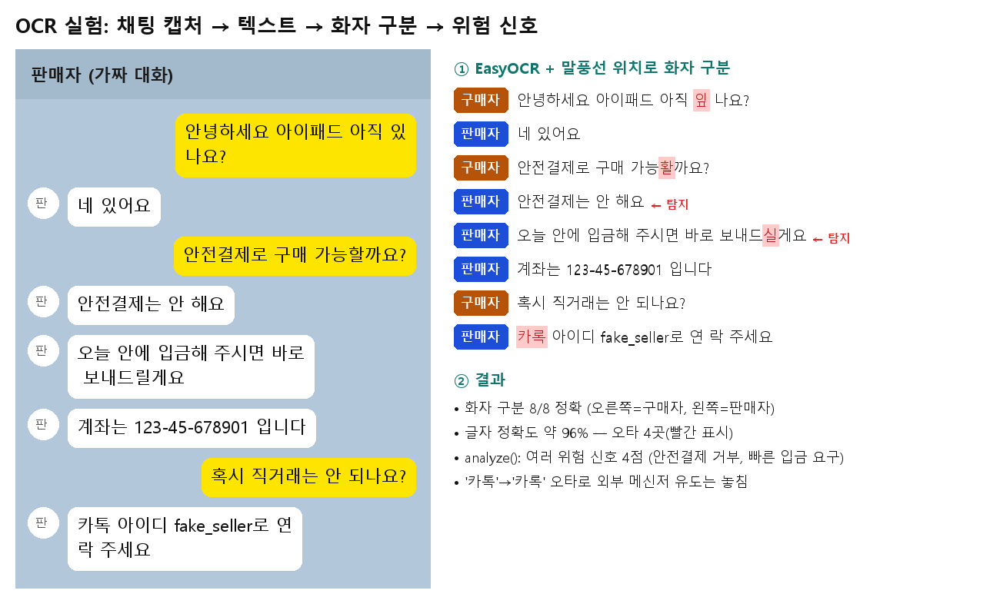
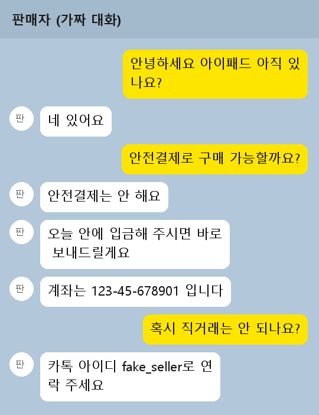

# OCR 실험 — 채팅 캡처 → 텍스트 → 파서 (1번)

> 중간 발표용 실험 1건입니다. 서비스 연결은 11/16 이후 진행합니다.
> 대화·계좌번호·아이디는 모두 **직접 만든 가짜 값**입니다.

## 발표용 요약



## 1. 실험 방법

| 항목 | 내용 |
|---|---|
| 입력 | 직접 만든 가짜 채팅 캡처 1장 (말풍선 8개, 540×702) |
| OCR | EasyOCR 1.7.2, 언어 `['ko', 'en']`, CPU |
| 화자 규칙 | 오른쪽 말풍선 = 구매자, 왼쪽 말풍선 = 판매자 ([#9](https://github.com/OSSTEAM5/sagijeone/issues/9)에서 합의) |
| 코드 | [`experiments/ocr_trial.py`](../experiments/ocr_trial.py) |

실행 (저장소 맨 위 폴더):

```
py -m pip install easyocr
py experiments/ocr_trial.py docs/images/ocr_sample_chat.png
```

두 가지 방법을 비교했습니다.

- **방법 A**: OCR 글자만 위에서부터 이어 붙여 `parse_chat()`에 넣기
- **방법 B**: OCR 박스의 **위치**로 말풍선을 묶고 화자를 정한 뒤 `판매자: … / 구매자: …` 형식으로 바꿔 `parse_chat()`에 넣기

## 2. 원본 캡처



## 3. OCR 결과 (박스별)

| 위치 (x, y) | 신뢰도 | 인식 텍스트 | 원문 |
|---|---|---|---|
| (218, 92) | 0.70 | 안녕하세요 아이패드 아직 **잎** | 안녕하세요 아이패드 아직 있 |
| (218, 126) | 1.00 | 나요? | 나요? |
| (78, 188) | 1.00 | 네 있어요 | 네 있어요 |
| (216, 252) | 0.67 | 안전결제로 구매 가능**활**까요? | 안전결제로 구매 가능할까요? |
| (78, 316) | 0.80 | 안전결제는 안 해요 | 안전결제는 안 해요 |
| (80, 380) | 0.96 | 오늘 안에 입금해 주시면 바로 | 〃 |
| (87, 414) | 0.46 | 보내드**실**게요 | 보내드릴게요 |
| (77, 475) | 0.61 | 계좌는 123-45-678901 | 〃 |
| (312, 478) | 0.99 | 입니다 | 입니다 |
| (254, 539) | 0.58 | 혹시 직거래는 안 되나요? | 혹시 직거래는 안 되나요? |
| (78, 605) | 0.51 | **카록** 아이디 fake_seller로 연 | 카톡 아이디 fake_seller로 연 |
| (78, 636) | 0.92 | 락 주세요 | 락 주세요 |

## 4. 파서 결과

### 방법 A — 글자만 이어 붙이기

말풍선 8개가 **13줄**로 쪼개지고, 화자는 전부 `unknown`이 됩니다.
채팅방 제목(`판매자 (가짜 대화)`)도 메시지로 섞여 들어갑니다.

```
{'index': 0, 'speaker': 'unknown', 'text': '판매자 (가짜 대화)'}
{'index': 1, 'speaker': 'unknown', 'text': '안녕하세요 아이패드 아직 잎'}
{'index': 2, 'speaker': 'unknown', 'text': '나요?'}
... (13줄)
```

### 방법 B — 말풍선 위치로 화자 구분

```
{'index': 0, 'speaker': 'buyer',  'text': '안녕하세요 아이패드 아직 잎 나요?'}
{'index': 1, 'speaker': 'seller', 'text': '네 있어요'}
{'index': 2, 'speaker': 'buyer',  'text': '안전결제로 구매 가능활까요?'}
{'index': 3, 'speaker': 'seller', 'text': '안전결제는 안 해요'}
{'index': 4, 'speaker': 'seller', 'text': '오늘 안에 입금해 주시면 바로 보내드실게요'}
{'index': 5, 'speaker': 'seller', 'text': '계좌는 123-45-678901 입니다'}
{'index': 6, 'speaker': 'buyer',  'text': '혹시 직거래는 안 되나요?'}
{'index': 7, 'speaker': 'seller', 'text': '카록 아이디 fake_seller로 연 락 주세요'}
```

`analyze()` 결과: **여러 위험 신호 (4점)** — 안전결제 거부, 빠른 입금 요구

| 비교 | 방법 A | 방법 B |
|---|---|---|
| 메시지 수 (정답 8) | 13 | **8** |
| 화자 정확도 | 0/8 (전부 unknown) | **8/8** |
| 글자 정확도 (공백 제외) | 약 96% | 약 96% |
| 탐지된 위험 신호 (정답 3) | 2/3 | 2/3 |
| 근거 문장 | 쪼개진 줄 (`오늘 안에 입금해 주시면 바로`) | 말풍선 전체 문장 |
| 구매자 말이 신호로 잡힐 위험 | 있음 (화자를 몰라 구매자 말도 검사) | 없음 (구매자 말은 건너뜀) |

## 5. 잘 된 점

- 말풍선 위치(왼쪽 끝이 화면 왼쪽 1/4 안이면 판매자)로 **화자 8개 모두 정확히 구분**
- 두 줄로 나뉜 말풍선, 한 줄이 두 박스로 쪼개진 경우(`계좌는 …` + `입니다`)를 **위아래 간격으로 다시 묶을 수 있음**
- 숫자·영문은 정확함 → `extract_accounts()`로 계좌번호 `123-45-678901` 추출 성공
- OCR 결과가 기존 `parse_chat()` → `analyze()` 흐름에 **그대로 연결됨**

## 6. 안 된 점 · 한계

1. **한글 오타**: 받침이 비슷한 글자를 틀림 (`있→잎`, `할→활`, `릴→실`, `톡→록`). 신뢰도가 0.5 안팎인 박스에서 주로 발생
2. **오타 때문에 신호를 놓침**: `카톡 → 카록`으로 읽혀서 **외부 메신저 이동 유도를 탐지하지 못함** (원문으로는 탐지됨)
3. **줄바꿈 위치의 띄어쓰기**: 단어 중간에서 줄이 바뀌면 `연 락`처럼 공백이 생김 → 키워드 매칭이 깨질 수 있음
4. **화면 구성에 의존**: 채팅방 제목 높이, 프로필 아이콘 위치, 줄 간격 기준값을 이 캡처에 맞춰 정함 → 다른 앱·해상도에서는 다시 조정 필요
5. **속도·크기**: 첫 실행 때 모델 약 95MB를 내려받음. 그 뒤에도 라이브러리 불러오기 약 7.5초 + 모델 준비 약 1.2초 + 인식 약 1초 (7번 항목에서 측정)

## 7. 방식 비교: EasyOCR vs Tesseract.js (이슈 #56)

같은 캡처(`docs/images/ocr_sample_chat.png`)를 브라우저용 OCR인 **Tesseract.js**로도 읽어서 비교했습니다.

| 항목 | 내용 |
|---|---|
| 도구 | Tesseract.js 5.1.1 (CDN), 언어 `kor+eng`, Chrome에서 실행 |
| 코드 | [`experiments/tesseract_trial.html`](../experiments/tesseract_trial.html) |
| 화자 구분 | EasyOCR 실험과 **같은 규칙**(말풍선 묶기 → 왼쪽 끝이 화면 1/4 안이면 판매자) |
| 흑백 전처리 (이슈에 없던 추가 시험) | 원본 그대로는 노란 말풍선을 못 읽어서 추가. 밝기 120 기준으로 검정/흰색만 남기고, 프로필 아이콘 영역(왼쪽 60px)은 흰색으로 지움 |

실행 (저장소 맨 위 폴더):

```
py -m http.server 8000
→ http://localhost:8000/experiments/tesseract_trial.html 에서 [OCR 실행]
```

### 비교표

| 항목 | EasyOCR | Tesseract.js (원본 그대로) | Tesseract.js (흑백 전처리) |
|---|---|---|---|
| 찾은 말풍선 (정답 8) | 8 | 5 (**노란 구매자 말풍선 3개 전부 놓침**) | **8** |
| 글자 정확도 (공백 제외) | 약 96% | 약 65% | **약 99%** |
| 화자 구분 | 8/8 | 판매자 5/5, 구매자 0/3 | **8/8** |
| 남은 오타 | `있→잎`, `할→활`, `릴→실`, `톡→록` | `네→20d`, 아이콘 `판`·기호가 글자로 섞임 | `fake_seller로→fake_seller2` 1곳 |
| `analyze()` 결과 (정답: 여러 위험 신호, 3종) | 여러 위험 신호, 3종 ✅ (#63 오타 보정으로 `카록→카톡`) | 여러 위험 신호, 3종 | 여러 위험 신호, 3종 ✅ |
| 처리 시간 (인식) | 약 1초 (모델 준비 약 1.2초, 라이브러리 불러오기 약 7.5초 별도) | 약 0.4초 | 약 0.4~1.5초 |
| 처음 받는 크기 | 모델 약 95MB + PyTorch 등 라이브러리 (torch만 약 560MB) | 언어 데이터 약 4.5MB (kor 1.6MB + eng 3.0MB), 브라우저가 한 번 받으면 저장 | 같음 |
| 메모리 (로컬 측정) | 최대 약 880MB (Python 프로세스) | 사용자 브라우저에서 처리 | 같음 |
| 실행 위치 | **서버** | **사용자 브라우저** (서버 부담 없음) | 같음 |
| 배포 가능 여부 | 5번 확인 결과(#60) 반영 예정 | 서버 필요 없음 | 서버 필요 없음 |

> 시간은 같은 노트북(CPU)에서 3번씩 잰 값입니다. 모델·언어 데이터를 이미 받은 상태 기준입니다.

### 알게 된 점

- **Tesseract.js는 원본 캡처 그대로 넣으면 노란 말풍선 글자를 통째로 못 읽음** → 흑백 전처리 한 단계만 넣으면 EasyOCR보다 오히려 정확했음
- 전처리하면 받침 오타(`있`, `할`, `릴`, `톡`)가 하나도 없었음. EasyOCR의 받침 오타 문제는 Tesseract.js에서는 나오지 않음
- 단어 위치(bbox)를 줄 단위로 받을 수 있어서 **EasyOCR과 같은 화자 구분 규칙을 그대로 쓸 수 있음**
- 프로필 아이콘이 글자와 같은 줄로 붙어서 인식됨 → 전처리에서 아이콘 영역을 지워서 해결
- EasyOCR은 메모리를 많이 써서(최대 약 880MB) 무료 서버에 올리기 부담이 큼. Tesseract.js는 서버가 할 일이 없음
- 이번 비교는 직접 만든 캡처 1장 기준이라, 실제 앱 캡처(`docs/images/samples/` 5장)에서도 같은 결과가 나오는지는 따로 확인이 필요함
