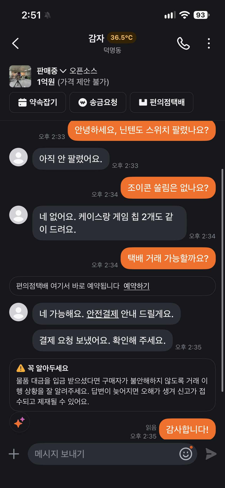
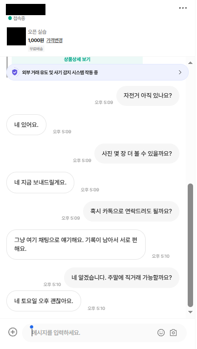
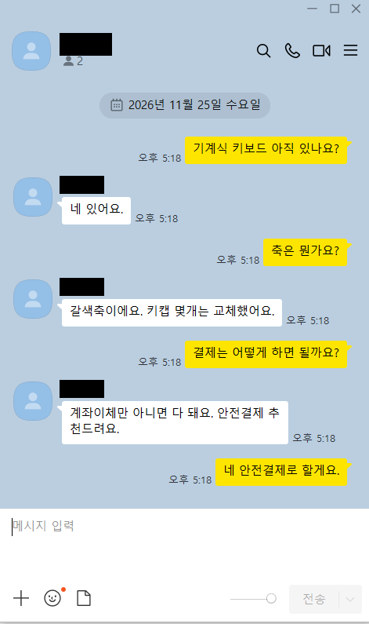
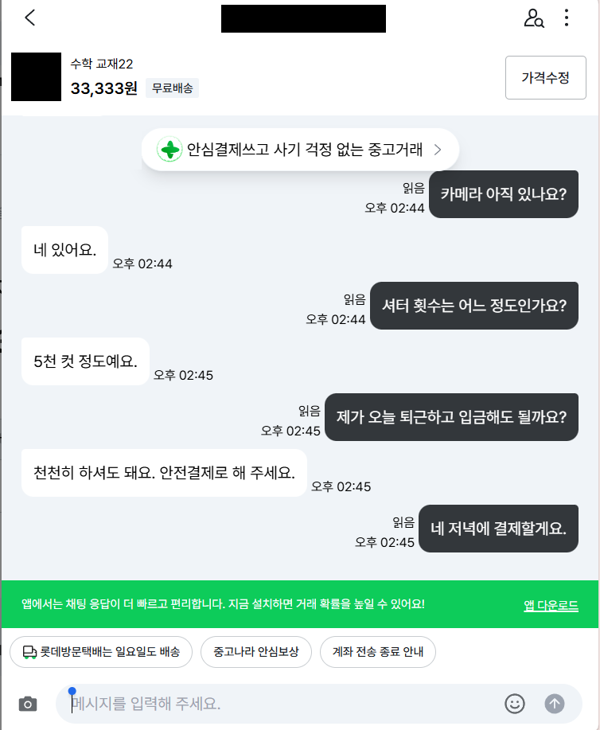
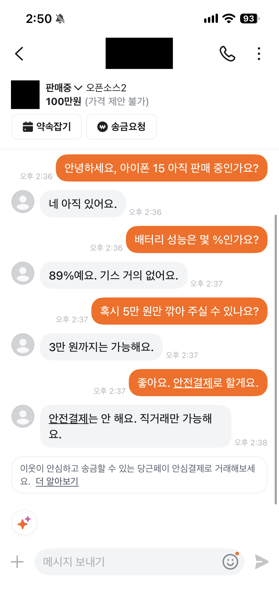
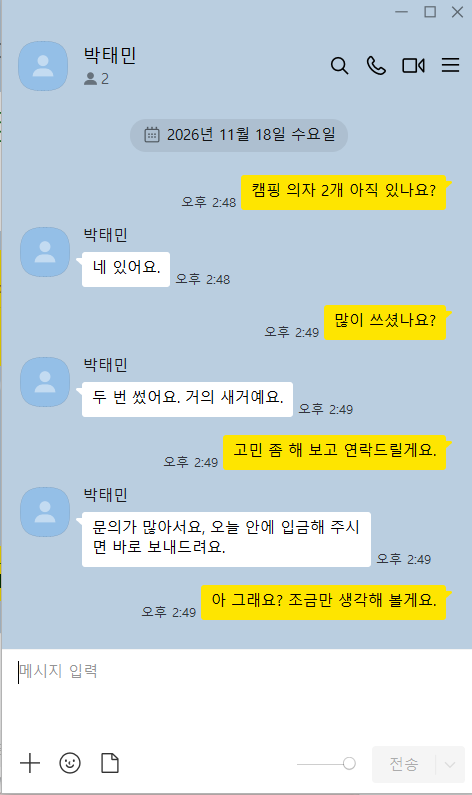
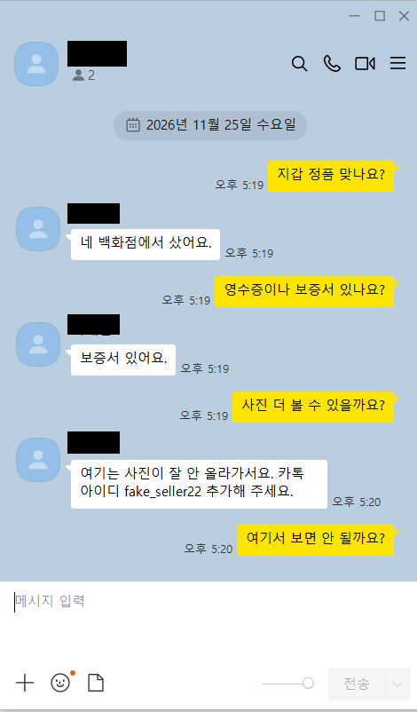
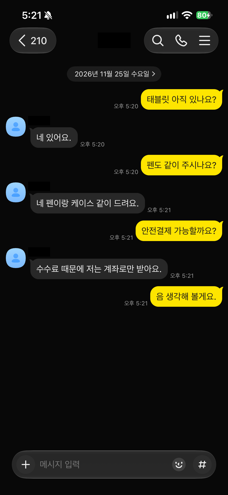
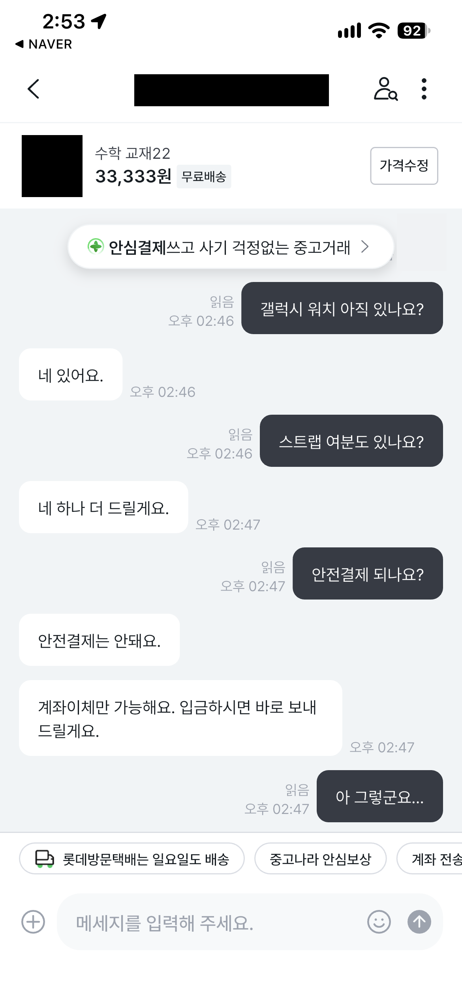
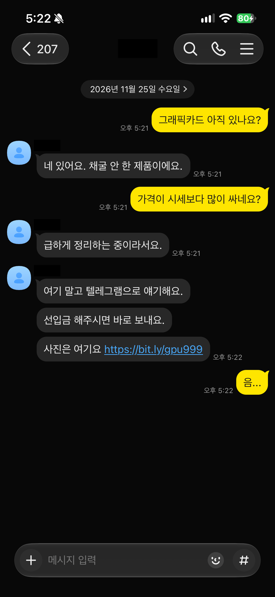

# 샘플 대화 20개 (이슈 #58)

12/6 오탐 비율 측정과 캡처 기능 테스트에 쓰는 표본입니다.

> 대화 속 아이디·주소·링크는 모두 **직접 만든 가짜 값**입니다. (`192.0.2.x`는 문서용 예시 IP 대역)

- 정상 10개 (N01~N10) — 그중 9개는 일부러 헷갈리게 만든 대화
- 위험 10개 (R01~R10) — 신호 8종류를 한 번 이상씩 포함, R09·R10은 여러 신호
- 실제 채팅처럼 인사·상태 질문·흥정 같은 평범한 말을 섞었고, 위험 신호는 대화 중간에 나오게 했습니다.
- 캡처의 닉네임·실명·동네·상품 사진은 가렸습니다. 당근 화면 중간의 안내 문구(꼭 알아두세요, 안심결제 안내 등)는 앱이 실제로 띄운 것이라 그대로 두었습니다.
- **기대 결과**: 사람이 판단한 정답 / **실제 결과**: `analyze()`를 돌린 결과

## 한눈에 보기

| 번호 | 구분 | 내용 | 기대 level | 실제 level | 일치 | 캡처 |
|---|---|---|---|---|---|---|
| N01 | 정상 | 기본 정상 대화 | 특이 신호 없음 | 특이 신호 없음 | ✅ |  |
| N02 | 정상(헷갈림) | 판매자가 '안전결제 안내'라고 말함 | 특이 신호 없음 | 특이 신호 없음 | ✅ | 당근 · 다크 |
| N03 | 정상(헷갈림) | '입금 확인했어요' (입금 단어가 나옴) | 특이 신호 없음 | 특이 신호 없음 | ✅ |  |
| N04 | 정상(헷갈림) | 구매자가 먼저 카톡을 물어봄 | 특이 신호 없음 | 특이 신호 없음 | ✅ |  |
| N05 | 정상(헷갈림) | '안전결제도 가능해요' | 특이 신호 없음 | 특이 신호 없음 | ✅ |  |
| N06 | 정상(헷갈림) | '계좌이체만 아니면 다 돼요' | 특이 신호 없음 | 특이 신호 없음 | ✅ |  |
| N07 | 정상(헷갈림) | 판매자가 진짜 공식 주소 링크를 보냄 | 특이 신호 없음 | 특이 신호 없음 | ✅ |  |
| N08 | 정상(헷갈림) | '우선 입금 말고' (선입금과 비슷한 글자) | 특이 신호 없음 | 특이 신호 없음 | ✅ |  |
| N09 | 정상(헷갈림) | '온라인으로' 안에 '라인으로'가 들어 있음 | 특이 신호 없음 | 특이 신호 없음 | ✅ |  |
| N10 | 정상(헷갈림) | 구매자만 '오늘 입금'이라고 말함 | 특이 신호 없음 | 특이 신호 없음 | ✅ | 중고나라 · 라이트 |
| R01 | 위험 | 안전결제 거부 | 주의 | 주의 | ✅ | 당근 · 라이트 |
| R02 | 위험 | 빠른 입금 요구 | 주의 | 주의 | ✅ | 카카오톡 · 라이트 |
| R03 | 위험 | 외부 메신저 이동 | 주의 | 주의 | ✅ |  |
| R04 | 위험 | 계좌이체만 요구 | 주의 | 주의 | ✅ |  |
| R05 | 위험 | 공식 사이트와 비슷한 주소 | 주의 | 주의 | ✅ |  |
| R06 | 위험 | 공식 사이트 사칭 | 주의 | 주의 | ✅ |  |
| R07 | 위험 | 단축 URL | 주의 | 주의 | ✅ |  |
| R08 | 위험 | IP 주소 링크 | 주의 | 주의 | ✅ |  |
| R09 | 위험(여러 개) | 안전결제 거부 + 계좌이체만 | 여러 위험 신호 | 여러 위험 신호 | ✅ | 중고나라 · 라이트 |
| R10 | 위험(여러 개) | 텔레그램 + 선입금 + 단축 URL | 여러 위험 신호 | 여러 위험 신호 | ✅ |  |

---

## N01. 정상 — 기본 정상 대화

```
구매자: 안녕하세요, 에어팟 프로 아직 있나요?
판매자: 네 아직 있어요!
구매자: 구매한 지 얼마나 되셨어요?
판매자: 작년 여름에 사서 1년 조금 넘었어요.
구매자: 배터리는 괜찮나요?
판매자: 네 하루 종일 써도 괜찮아요.
구매자: 그럼 안전결제로 살게요.
판매자: 네 결제해 주시면 내일 택배로 보내드릴게요.
```

| 항목 | 기대 결과 | 실제 결과 |
|---|---|---|
| level | 특이 신호 없음 | 특이 신호 없음 |
| 신호 | 없음 | 없음 |

캡처: (없음)

## N02. 정상(헷갈림) — 판매자가 '안전결제 안내'라고 말함

```
구매자: 안녕하세요, 닌텐도 스위치 팔렸나요?
판매자: 아직 안 팔렸어요.
구매자: 조이콘 쏠림은 없나요?
판매자: 네 없어요. 케이스랑 게임 칩 2개도 같이 드려요.
구매자: 택배 거래 가능할까요?
판매자: 네 가능해요. 안전결제 안내 드릴게요.
판매자: 결제 요청 보냈어요. 확인해 주세요.
구매자: 감사합니다!
```

| 항목 | 기대 결과 | 실제 결과 |
|---|---|---|
| level | 특이 신호 없음 | 특이 신호 없음 |
| 신호 | 없음 | 없음 |

캡처: 

## N03. 정상(헷갈림) — '입금 확인했어요' (입금 단어가 나옴)

```
구매자: 전공책 3권 묶음 아직 있나요?
판매자: 네 있어요. 필기는 거의 없어요.
구매자: 택배비 포함 가격인가요?
판매자: 네 택배비 포함이에요.
구매자: 방금 안전결제로 입금했어요.
판매자: 입금 확인했어요. 오늘 바로 택배 보낼게요.
판매자: 송장번호는 내일 알려드릴게요.
구매자: 감사합니다!
```

| 항목 | 기대 결과 | 실제 결과 |
|---|---|---|
| level | 특이 신호 없음 | 특이 신호 없음 |
| 신호 | 없음 | 없음 |

캡처: (없음)

## N04. 정상(헷갈림) — 구매자가 먼저 카톡을 물어봄

```
구매자: 자전거 아직 있나요?
판매자: 네 있어요.
구매자: 사진 몇 장 더 볼 수 있을까요?
판매자: 네 지금 보내드릴게요.
구매자: 혹시 카톡으로 연락드려도 될까요?
판매자: 그냥 여기 채팅으로 얘기해요. 기록이 남아서 서로 편해요.
구매자: 네 알겠습니다. 주말에 직거래 가능할까요?
판매자: 네 토요일 오후 괜찮아요.
```

| 항목 | 기대 결과 | 실제 결과 |
|---|---|---|
| level | 특이 신호 없음 | 특이 신호 없음 |
| 신호 | 없음 | 없음 |

캡처: 

## N05. 정상(헷갈림) — '안전결제도 가능해요'

```
구매자: 모니터 아직 판매하시나요?
판매자: 네 판매 중이에요.
구매자: 불량 화소는 없나요?
판매자: 네 없어요. 박스도 있어요.
구매자: 직거래가 어려워서요. 택배 되나요?
판매자: 네 택배 되고 안전결제도 가능해요.
구매자: 그럼 안전결제로 할게요.
판매자: 네 포장 꼼꼼히 해서 보낼게요.
```

| 항목 | 기대 결과 | 실제 결과 |
|---|---|---|
| level | 특이 신호 없음 | 특이 신호 없음 |
| 신호 | 없음 | 없음 |

캡처: (없음)

## N06. 정상(헷갈림) — '계좌이체만 아니면 다 돼요'

```
구매자: 기계식 키보드 아직 있나요?
판매자: 네 있어요.
구매자: 축은 뭔가요?
판매자: 갈색축이에요. 키캡 몇 개는 교체했어요.
구매자: 결제는 어떻게 하면 될까요?
판매자: 계좌이체만 아니면 다 돼요. 안전결제 추천드려요.
구매자: 네 안전결제로 할게요.
```

| 항목 | 기대 결과 | 실제 결과 |
|---|---|---|
| level | 특이 신호 없음 | 특이 신호 없음 |
| 신호 | 없음 | 없음 |

캡처: 

## N07. 정상(헷갈림) — 판매자가 진짜 공식 주소 링크를 보냄

```
구매자: 패딩 사이즈가 어떻게 되나요?
판매자: 100 사이즈예요. 두 번 입었어요.
구매자: 혹시 다른 옷도 파시나요?
판매자: 네 몇 개 더 올려 뒀어요.
판매자: 제 다른 판매 물건은 https://www.daangn.com 에서 제 프로필 누르시면 보여요.
구매자: 감사합니다. 같이 사면 조금 깎아 주실 수 있나요?
판매자: 두 개 사시면 5천 원 빼 드릴게요.
```

| 항목 | 기대 결과 | 실제 결과 |
|---|---|---|
| level | 특이 신호 없음 | 특이 신호 없음 |
| 신호 | 없음 | 없음 |

캡처: (없음)

## N08. 정상(헷갈림) — '우선 입금 말고' (선입금과 비슷한 글자)

```
구매자: 캠핑 텐트 아직 있나요?
판매자: 네 있어요.
구매자: 4인용 맞죠? 구성품 다 있나요?
판매자: 네 팩이랑 폴대 다 있어요.
구매자: 예약하려면 돈을 먼저 보내야 하나요?
판매자: 아니요, 우선 입금 말고 만나서 확인하고 주세요.
구매자: 좋아요. 일요일에 역 앞에서 뵐게요.
판매자: 네 그때 뵐게요.
```

| 항목 | 기대 결과 | 실제 결과 |
|---|---|---|
| level | 특이 신호 없음 | 특이 신호 없음 |
| 신호 | 없음 | 없음 |

캡처: (없음)

## N09. 정상(헷갈림) — '온라인으로' 안에 '라인으로'가 들어 있음

```
구매자: 무선 청소기 아직 판매 중인가요?
판매자: 네 판매 중이에요.
구매자: 새 제품인데 왜 이렇게 싸요?
판매자: 선물 받았는데 이미 하나 있어서요.
판매자: 온라인으로 산 것보다 싸게 내놨어요.
구매자: 직거래 가능할까요?
판매자: 네 직거래 가능해요. 평일 저녁 괜찮아요.
```

| 항목 | 기대 결과 | 실제 결과 |
|---|---|---|
| level | 특이 신호 없음 | 특이 신호 없음 |
| 신호 | 없음 | 없음 |

캡처: (없음)

## N10. 정상(헷갈림) — 구매자만 '오늘 입금'이라고 말함

```
구매자: 카메라 아직 있나요?
판매자: 네 있어요.
구매자: 셔터 횟수는 어느 정도인가요?
판매자: 5천 컷 정도예요.
구매자: 제가 오늘 퇴근하고 입금해도 될까요?
판매자: 천천히 하셔도 돼요. 안전결제로 해 주세요.
구매자: 네 저녁에 결제할게요.
```

| 항목 | 기대 결과 | 실제 결과 |
|---|---|---|
| level | 특이 신호 없음 | 특이 신호 없음 |
| 신호 | 없음 | 없음 |

캡처: 

> 캡처 메모: 같은 채팅방의 이전 대화 한 줄과 PC 작업표시줄은 잘라 냈습니다. 화면 위의 '안심결제' 배너는 앱이 띄운 안내입니다.

## R01. 위험 — 안전결제 거부

```
구매자: 안녕하세요, 아이폰 15 아직 판매 중인가요?
판매자: 네 아직 있어요.
구매자: 배터리 성능은 몇 %인가요?
판매자: 89%예요. 기스 거의 없어요.
구매자: 혹시 5만 원만 깎아 주실 수 있나요?
판매자: 3만 원까지는 가능해요.
구매자: 좋아요. 안전결제로 할게요.
판매자: 안전결제는 안 해요. 직거래만 가능해요.
```

| 항목 | 기대 결과 | 실제 결과 |
|---|---|---|
| level | 주의 | 주의 |
| 신호 | `SAFE_PAYMENT_REFUSAL` (안전결제 거부) | `SAFE_PAYMENT_REFUSAL` (안전결제 거부) |

캡처: 

## R02. 위험 — 빠른 입금 요구

```
구매자: 캠핑 의자 2개 아직 있나요?
판매자: 네 있어요.
구매자: 많이 쓰셨나요?
판매자: 두 번 썼어요. 거의 새거예요.
구매자: 고민 좀 해 보고 연락드릴게요.
판매자: 문의가 많아서요, 오늘 안에 입금해 주시면 바로 보내드려요.
구매자: 아 그래요? 조금만 생각해 볼게요.
```

| 항목 | 기대 결과 | 실제 결과 |
|---|---|---|
| level | 주의 | 주의 |
| 신호 | `PAYMENT_PRESSURE` (빠른 입금 요구) | `PAYMENT_PRESSURE` (빠른 입금 요구) |

캡처: 

## R03. 위험 — 외부 메신저 이동

```
구매자: 지갑 정품 맞나요?
판매자: 네 백화점에서 샀어요.
구매자: 영수증이나 보증서 있나요?
판매자: 보증서 있어요.
구매자: 사진 더 볼 수 있을까요?
판매자: 여기는 사진이 잘 안 올라가서요. 카톡 아이디 fake_seller22 추가해 주세요.
구매자: 여기서 보면 안 될까요?
```

| 항목 | 기대 결과 | 실제 결과 |
|---|---|---|
| level | 주의 | 주의 |
| 신호 | `EXTERNAL_MESSENGER` (외부 메신저 이동 유도) | `EXTERNAL_MESSENGER` (외부 메신저 이동 유도) |

캡처: 

## R04. 위험 — 계좌이체만 요구

```
구매자: 태블릿 아직 있나요?
판매자: 네 있어요.
구매자: 펜도 같이 주시나요?
판매자: 네 펜이랑 케이스 같이 드려요.
구매자: 안전결제 가능할까요?
판매자: 수수료 때문에 저는 계좌로만 받아요.
구매자: 음 생각해 볼게요.
```

| 항목 | 기대 결과 | 실제 결과 |
|---|---|---|
| level | 주의 | 주의 |
| 신호 | `BANK_TRANSFER_ONLY` (계좌이체만 요구) | `BANK_TRANSFER_ONLY` (계좌이체만 요구) |

캡처: 

## R05. 위험 — 공식 사이트와 비슷한 주소

```
구매자: 노트북 아직 판매하시나요?
판매자: 네 판매 중이에요.
구매자: 램은 몇 기가인가요?
판매자: 16기가예요. 충전기도 드려요.
구매자: 택배로 받고 싶어요. 어떻게 결제하면 돼요?
판매자: 이 링크로 결제해 주세요 https://daangn-pay.com/order
구매자: 앱 안에서 하는 거랑 다른 건가요?
```

| 항목 | 기대 결과 | 실제 결과 |
|---|---|---|
| level | 주의 | 주의 |
| 신호 | `URL_LOOKALIKE` (공식 사이트와 비슷한 주소) | `URL_LOOKALIKE` (공식 사이트와 비슷한 주소) |

캡처: (없음)

## R06. 위험 — 공식 사이트 사칭

```
구매자: 콘서트 티켓 2장 아직 있나요?
판매자: 네 있어요. 연석이에요.
구매자: 정가에 파시는 거죠?
판매자: 네 정가 그대로예요.
구매자: 결제 방법 알려주세요.
판매자: 당근 결제창이에요 https://daangn.com.safe-pay.net/checkout
구매자: 주소가 좀 이상한 것 같은데요?
```

| 항목 | 기대 결과 | 실제 결과 |
|---|---|---|
| level | 주의 | 주의 |
| 신호 | `URL_IMPERSONATION` (공식 사이트 사칭 의심) | `URL_IMPERSONATION` (공식 사이트 사칭 의심) |

캡처: (없음)

## R07. 위험 — 단축 URL

```
구매자: 운동화 사이즈가 어떻게 되나요?
판매자: 270이에요.
구매자: 실착은 몇 번 하셨어요?
판매자: 한 번 신었어요.
구매자: 상품 정보 더 있나요?
판매자: 자세한 사진은 여기 보세요 https://bit.ly/fake123
구매자: 네 확인해 볼게요.
```

| 항목 | 기대 결과 | 실제 결과 |
|---|---|---|
| level | 주의 | 주의 |
| 신호 | `URL_SHORTENER` (단축 URL) | `URL_SHORTENER` (단축 URL) |

캡처: (없음)

## R08. 위험 — IP 주소 링크

```
구매자: 게임기 아직 있나요?
판매자: 네 있어요.
구매자: 패드 2개 포함인가요?
판매자: 네 2개 다 드려요.
구매자: 결제는 어떻게 하나요?
판매자: 여기서 결제해 주세요 http://192.0.2.10/pay
구매자: 이건 어디 사이트예요?
```

| 항목 | 기대 결과 | 실제 결과 |
|---|---|---|
| level | 주의 | 주의 |
| 신호 | `URL_IP_ADDRESS` (IP 주소로 된 링크) | `URL_IP_ADDRESS` (IP 주소로 된 링크) |

캡처: (없음)

## R09. 위험(여러 개) — 안전결제 거부 + 계좌이체만

```
구매자: 갤럭시 워치 아직 있나요?
판매자: 네 있어요.
구매자: 스트랩 여분도 있나요?
판매자: 네 하나 더 드릴게요.
구매자: 안전결제 되나요?
판매자: 안전결제는 안돼요.
판매자: 계좌이체만 가능해요. 입금하시면 바로 보내드릴게요.
구매자: 아 그렇군요...
```

| 항목 | 기대 결과 | 실제 결과 |
|---|---|---|
| level | 여러 위험 신호 | 여러 위험 신호 |
| 신호 | `BANK_TRANSFER_ONLY` (계좌이체만 요구), `SAFE_PAYMENT_REFUSAL` (안전결제 거부) | `BANK_TRANSFER_ONLY` (계좌이체만 요구), `SAFE_PAYMENT_REFUSAL` (안전결제 거부) |

캡처: 

> 캡처 메모: 대화와 상관없는 '.' 말풍선 하나를 지웠습니다. 화면 위의 '안심결제' 배너는 앱이 띄운 안내입니다.

## R10. 위험(여러 개) — 텔레그램 + 선입금 + 단축 URL

```
구매자: 그래픽카드 아직 있나요?
판매자: 네 있어요. 채굴 안 한 제품이에요.
구매자: 가격이 시세보다 많이 싸네요?
판매자: 급하게 정리하는 중이라서요.
판매자: 여기 말고 텔레그램으로 얘기해요.
판매자: 선입금 해주시면 바로 보내요.
판매자: 사진은 여기요 https://bit.ly/gpu999
구매자: 음...
```

| 항목 | 기대 결과 | 실제 결과 |
|---|---|---|
| level | 여러 위험 신호 | 여러 위험 신호 |
| 신호 | `EXTERNAL_MESSENGER` (외부 메신저 이동 유도), `PAYMENT_PRESSURE` (빠른 입금 요구), `URL_SHORTENER` (단축 URL) | `EXTERNAL_MESSENGER` (외부 메신저 이동 유도), `PAYMENT_PRESSURE` (빠른 입금 요구), `URL_SHORTENER` (단축 URL) |

캡처: 

---

## 대화를 고칠 때

- 대화를 바꾸면 `check.py`로 다시 돌려서 **실제 결과** 칸도 같이 고치세요.
- 기대와 실제가 다르면 고치지 말고 ❌로 남겨 두세요. 오탐 측정에 쓰입니다.
- 캡처를 연결할 때는 `캡처: (없음 ...)` 줄을 `캡처: `처럼 바꾸세요.
